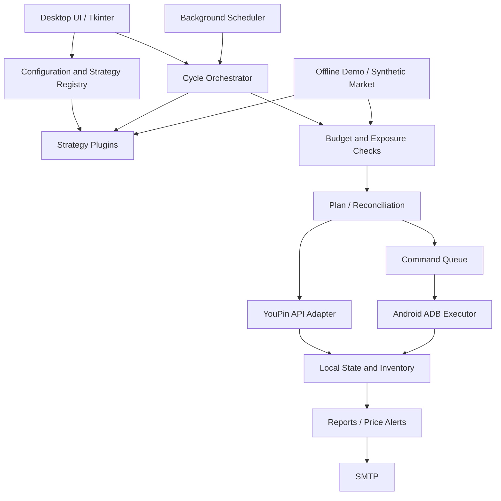

# YouPin Automation Workbench

[](https://github.com/Joy1-Song/youpin-automation-workbench/actions/workflows/tests.yml)

**饰品自动求购与库存管理桌面工作台**。一个从个人真实需求迭代而来的 Python / Tkinter 项目：将策略计算、预算风控、交易执行和通知拆分，桌面端负责配置、查看与人工干预。

> 本仓库是脱敏的作品集版本。默认关闭交易提交；离线演示只使用合成数据，不需要账号、模拟器或 SMTP。它不是官方客户端，不是证券交易系统，也不提供收益承诺。项目采用 AI 辅助开发，不包含 LLM 推理或 RAG 功能。

## 快速体验

Python **3.11+**，从仓库根目录运行。离线演示仅依赖标准库：

```bash
git clone https://github.com/Joy1-Song/youpin-automation-workbench.git
cd youpin-automation-workbench
python demo.py
```

演示调用真实策略与风控模块，覆盖以下流程，不执行网络请求或交易：

1. 从 12 个合成候选中选出最低价的 10 个品类。
2. 计算求购价格与数量，生成部分成交订单的撤销计划。
3. 模拟确认撤销后重新生成计划，校验当日成交与未成交敞口。
4. 将同一计划入队两次，验证仍只有 10 个待处理指令。
5. 验证出货从空仓位补到 3 张，已有 3 张正确在售时不再新增。

演示输出为 JSON，临时队列在结束后清理；它不会读取 `.env` 或 `config.local.json`。

## 功能与实现

| 能力 | 实现要点 | 代码入口 |
| --- | --- | --- |
| 桌面工作台 | Tkinter、后台线程、队列回传 UI，策略选择、挂单与库存管理 | `youpin_desktop_app.py` |
| 可插拔策略 | 选品、定价、数量分配接口；动态发现桌面策略配置 | `strategies/`、`youpin_strategy_registry.py` |
| 求购计划 | 最低价 10 类、目标第二顺位、单品数量约束、周期撤单重建 | `youpin_major_bidder.py`、`youpin_order_reconciler.py` |
| 预算风控 | Decimal 金额、每日零点或滚动窗口、成交去重、未成交敞口检查 | `youpin_risk_manager.py` |
| 执行桥接 | API 适配 + ADB 执行队列、指令状态历史、待处理指令去重 | `youpin_execution_bridge.py`、`youpin_emulator_executor.py` |
| 出货对账 | 按品类维持最多 3 张在售；调价前撤单；毛涨幅不足时撤销 | `strategies/cs2_2026_cologne_profit_exit.py` |
| 成本补全 | 根据购买记录与库存关联，辅助回填购入价 | `youpin_buy_price_fill.py` |
| 监控与通知 | 日报、买卖双阈值预警、CS2 更新检测、状态记录 | `youpin_daily_report.py`、`youpin_price_alert.py` |

“第二顺位”是依据读取时盘口计算的目标，实际队列还受同价订单、到达时间和市场变化影响。出货的 50% 阈值按**最终报价相对记录成本的毛涨幅**计算，不包含费用或保证成交。

## 架构



模块职责已经拆分，但还不是完全解耦的领域架构。编排和桌面入口仍偏大，部分模块存在兼容包装和反向依赖；当前边界与后续拆分方向见 [架构说明](docs/architecture.md)。

## 本地验证

```bash
python -m pip install -r requirements-dev.txt
python -m pytest -q
python youpin_major_bidder.py --self-test
python scripts/check_publication.py
```

测试使用合成数据和假客户端，自动阻止网络连接及子进程调用。CI 在 Windows / Ubuntu 的 Python 3.11、3.12 上运行离线测试。测试不验证当前第三方平台接口的可用性或真实成交。

## 桌面端

Windows 版本需要带 Tkinter 的 Python；实际执行另外需要本地 Android SDK / ADB、模拟器及用户自行登录的账号。

```powershell
Copy-Item config.example.json config.local.json
Copy-Item .env.example .env
python youpin_desktop_app.py
```

这些命令用于全新克隆，不要覆盖已有实盘配置。桌面端不是离线演示入口，在线查询需要有效登录态。不要同时启动多个执行器；实盘前先阅读 [运行边界与配置](docs/operations.md)。

## 文档导航

- [模块职责、数据流与局限](docs/architecture.md)
- [策略接入接口](STRATEGY_INTERFACE.md)
- [成本回填模块](BUY_PRICE_FILL.md)
- [价格预警模块](PRICE_ALERT.md)
- [配置、故障恢复与安全](docs/operations.md)
- [代码检查与测试记录](docs/validation.md)
- [简历表述与工程证据](docs/portfolio.md)
- [贡献约定](CONTRIBUTING.md) / [安全说明](SECURITY.md)

仓库不包含个人交易记录、收益截图、账号凭据、模拟器镜像或个人简历。第三方接口与 APP 布局可能变化，适配代码只代表项目开发时的实现，不承诺当前平台支持自动化。
